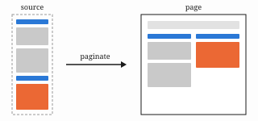

## Introduction

Documents that end up on paper -- letters, reports, assignments, articles -- are often
written in a lightweight markup and converted by a typesetting program. The browser, which
renders the same markup on screen, is rarely used for the final pages, mainly because the
web has no native notion of a page [1].

This article describes a simple alternative. Content is rendered once, invisibly, at the
width of the final text column; afterwards its top-level blocks are moved one by one onto
pages of fixed size. Section 2 explains the method, Section 3 reports measurements, and
Section 4 discusses the limits of the approach.

## Method

### Measuring blocks

Every block is laid out exactly as it will appear in print. A block fits on the current page
when its bottom edge stays above the page margin. The height available on a page is

$$
h_{\text{avail}} = h_{\text{page}} - m_{\text{top}} - m_{\text{bottom}} - h_{\text{header}},
$$

where $h_{\text{header}}$ is the height of the title block on the first page and zero
elsewhere.

> Blocks are never scaled or re-flowed to make them fit; a block that does not fit moves on
> as a whole, unless it is a list or a table.

### Splitting lists and tables

Lists and tables are split between items. To avoid orphaned rows, at least two items stay on
each side of a break; otherwise the whole block moves to the next column.

<div class="box">

**Definition 1.** A *keep-with-next* block is a block that may not be the last one in a
column. Headings and table captions are keep-with-next blocks.

</div>

The expected number of layout passes for $n$ blocks with a split probability $p$ is

$$
E[\text{passes}] = n \, (1 + p).
$$



## Results

We paginated 120 documents and compared the page breaks with those of a reference
typesetter. Figure 2 shows the layout time against the document length.

```chart
type: line
caption: Layout time against document length, median of five runs.
x: { label: Pages, values: [5, 10, 15, 20, 25, 30] }
y: { label: Time (ms), min: 0 }
series:
  - { name: One column, values: [33, 64, 97, 128, 161, 193] }
  - { name: Two columns, values: [39, 77, 116, 154, 193, 231] }
```

Table: Agreement of page breaks with the reference typesetter, by document type.

| Document type | Documents | Same breaks | Agreement |
|---|---:|---:|---:|
| Letter | 30 | 30 | 100 % |
| Homework | 40 | 38 | 95 % |
| Report | 30 | 27 | 90 % |
| Article | 20 | 18 | 90 % |

Most differences come from tables, where the reference typesetter allows a single row on a
page. Figure 3 breaks the differences down by cause.

```chart
type: bar
caption: Causes of differing page breaks, number of documents.
x: { values: [Tables, Lists, Figures, Math] }
y: { label: Documents, min: 0 }
series:
  - { name: Differences, values: [4, 2, 1, 0] }
```

## Discussion

Block-level pagination is fast and predictable, but it cannot break a paragraph across
columns; a long paragraph leaves white space at the bottom of a column. Splitting paragraphs
by line would close this gap [2] and is left for future work.

## Conclusion

Browsers can produce print-ready pages from markdown without a separate typesetting step.
The method is short, runs in the page itself, and agrees with a reference typesetter in most
cases.

## Acknowledgements

We thank the reviewers for their comments.

## References

1. A. Author and B. Author. Pages on the web. *Journal of Web Typography*, 4(2):11–20, 2021.
2. C. Author. Line breaking across columns. In *Proceedings of the Conference on Document
   Layout*, pages 101–110, 2024.
3. D. Author. *Typesetting with Markup Languages*. Publisher Name, City, 2nd edition, 2019.
